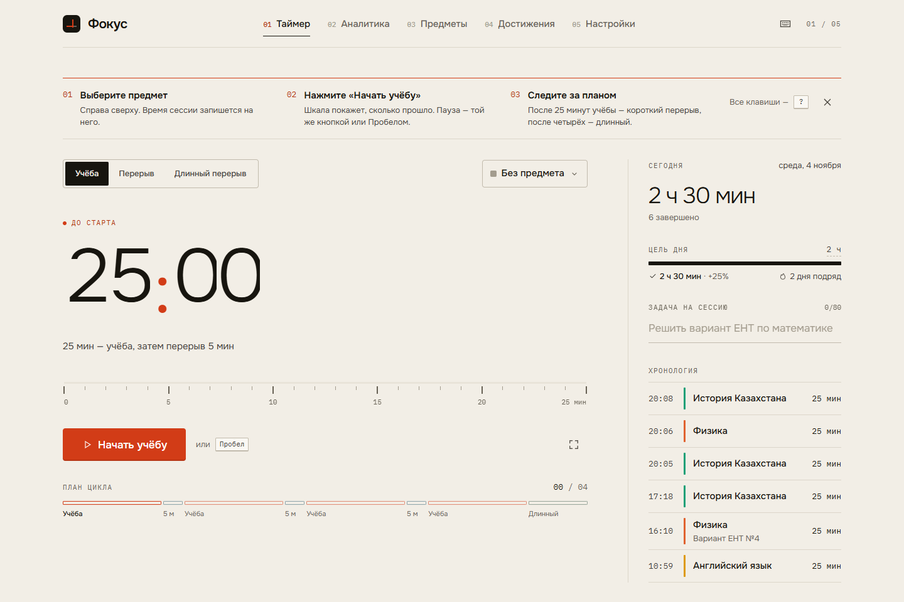
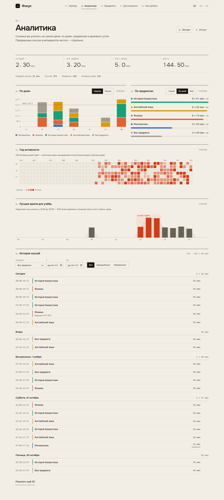
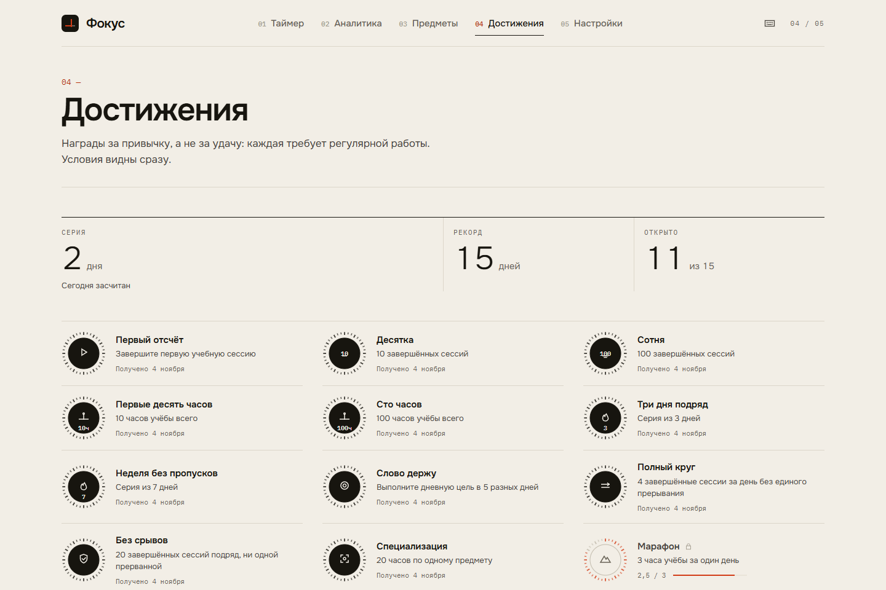
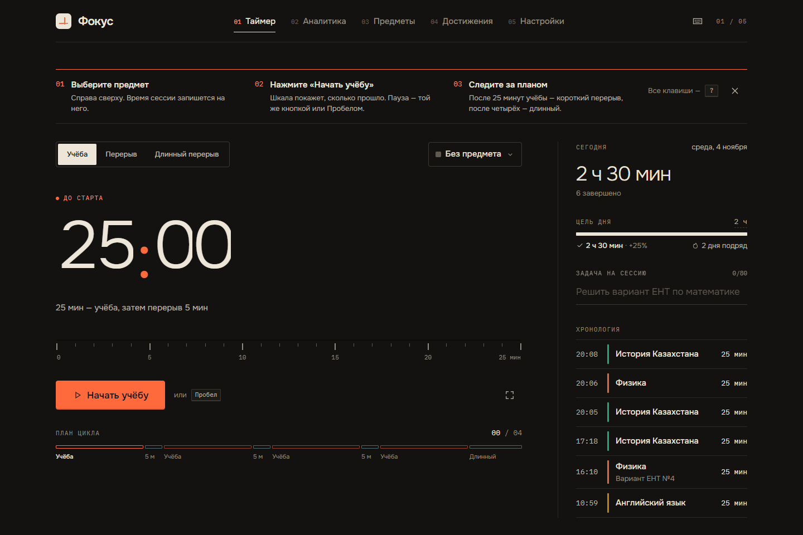
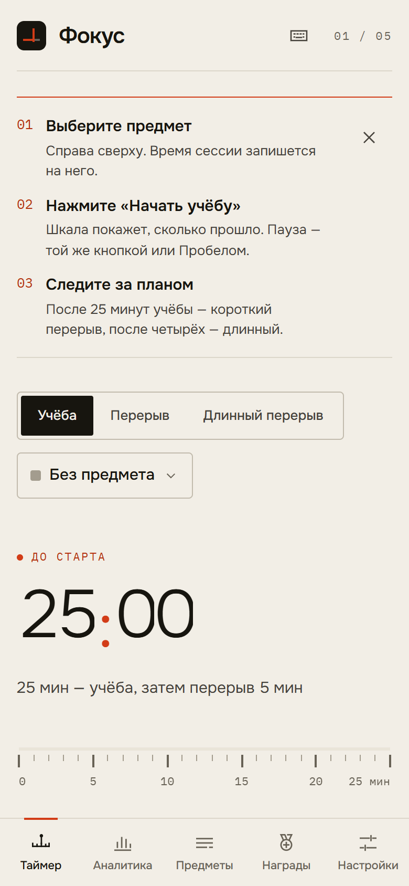

# Фокус — учебный таймер

Таймер по методу Помодоро для школьников 8–11 классов и студентов: короткие сессии учёбы и перерывов, время по предметам, честная статистика и привычка через серии дней.



## Проблема

Ученик садится «позаниматься» на вечер и не знает, сколько на самом деле учился: отвлёкся на телефон, переключился на другой предмет, бросил на середине. Перед ЕНТ и сессией это превращается в тревогу «я ничего не успеваю», хотя данных, чтобы это проверить, нет.

## Цель

Сделать время учёбы видимым и измеримым:

- работать короткими сессиями с перерывами — так проще начать и держать внимание;
- привязывать каждую сессию к предмету и задаче («Решить вариант ЕНТ по математике»);
- показывать реальную картину: сколько, по каким предметам, в какое время суток, сколько сессий прервано;
- поддерживать регулярность серией дней, дневной целью и достижениями.

## Аудитория

Ученики 8–11 классов и студенты, особенно в период подготовки к ЕНТ и сессии. Интерфейс на русском, работает на телефоне (от 360 px) и на компьютере, ставится как приложение и работает без интернета.

## Функции

**Таймер**

- Режимы: учёба, короткий перерыв, длинный перерыв (после N циклов). Все длительности настраиваются.
- Крупные «катящиеся» цифры, линейная шкала по минутам с меткой «сейчас», план цикла.
- Предмет и задача на сессию. Кнопка «Прервать» записывает сессию как прерванную (честный учёт). Пропуск учёбы не засчитывает цикл.
- Режим полного фокуса: только время и линия прогресса, полноэкранно, выход по Esc.
- Сигналы Web Audio (камертон, спуск, колокол, аккорд) с мягким нарастанием громкости, уведомления, время и режим в заголовке вкладки.
- Активная сессия восстанавливается после перезагрузки, вкладки синхронизируются между собой.

**Предметы**: добавление, переименование, перекраска из курированной палитры (8 цветов, проверенных на различимость при дальтонизме), перетаскивание, архив вместо удаления, быстрые пресеты предметов ЕНТ.

**Аналитика**

- Сводка: сегодня, неделя, месяц, всего; средняя сессия; доля прерванных; активные дни.
- Столбики по дням (неделя / месяц), сложенные по предметам, с линией дневной цели.
- Распределение по предметам — горизонтальные полосы с прямыми подписями.
- Год активности — тепловая карта с уровнями по личному перцентилю.
- «Лучшее время для учёбы» — распределение по часам и самое продуктивное трёхчасовое окно.
- История с фильтрами по предмету, датам и статусу. У каждого графика есть вид «таблица».
- Экспорт и импорт резервной копии в JSON (проверка схемой, объединение или замена).

**Привычки**: серия дней и рекорд, дневная цель в минутах или сессиях, 15 достижений с прогрессом и собственными SVG-медалями.

**Настройки**: длительности, автостарт, цель, звук и громкость, уведомления, тема (системная / светлая / тёмная), удаление данных с подтверждением.

**Горячие клавиши**

| Клавиша   | Действие                          |
| --------- | --------------------------------- |
| Пробел    | Старт / пауза                     |
| R         | Сбросить текущую сессию           |
| S         | Пропустить к следующему режиму    |
| 1 / 2 / 3 | Учёба / перерыв / длинный перерыв |
| F         | Режим полного фокуса              |
| Esc       | Выйти из режима фокуса или окна   |
| ?         | Справка по клавишам               |

Клавиши привязаны к физическим кнопкам, поэтому R и S работают и в русской раскладке.

## Скриншоты

| Аналитика                                              | Достижения                                                     |
| ------------------------------------------------------ | -------------------------------------------------------------- |
|  |  |

| Тёмная тема                                             | Телефон                                             |
| ------------------------------------------------------- | --------------------------------------------------- |
|  |  |

## Архитектура

```
src/
  app/                 каркас: роутер, раскладка, горячие клавиши, PWA-обновление
  features/
    timer/
      model/           конечный автомат (чистые функции) + типы
      clock/           Web Worker и планировщик тиков
      ui/              экран таймера, шкала, цифры, план цикла, режим фокуса
      store.ts         Zustand-стор автомата с сохранением
      runtime.ts       связь автомата с часами, звуком, уведомлениями, заголовком
    sessions/          запись сессий, стор, панель «Сегодня»
    subjects/          палитра, стор и репозиторий, страница, выбор предмета
    stats/             агрегаты (чистые функции), SVG-графики, история
    habits/            серии и цель дня
    achievements/      декларативные правила, медали, синхронизация
    settings/          стор настроек, тема, резервная копия, страница
  ui/                  собственные компоненты: Button, Segmented, Dialog, Field, Switch,
                       Stepper, Slider, Toasts, EmptyState, PageHeader, иконки
  lib/                 Dexie, даты, форматирование, звук, уведомления, горячие клавиши
  styles/              дизайн-токены и базовые стили
```

**Автомат таймера.** `transition(state, event) → { state, effects }` — чистая функция без побочных эффектов и без `Date.now()` внутри: время передаётся в событии. Состояния `idle → running ⇄ paused → finished`, у каждого есть режим и номер цикла. Время не «тикает», а вычисляется по меткам (`anchor`, `banked`), поэтому фоновая вкладка ничего не сбивает. Эффекты (`record`, `signal`, `clock`) выполняет отдельный слой. Автостарт начинается с точного момента дедлайна, а если вкладка проспала несколько сессий, цепочка догоняется. После долгого отсутствия сессия закрывается без автостарта.

**Часы.** Web Worker присылает тики, выровненные по границам секунд относительно дедлайна, и событие `deadline`. Если Worker недоступен, тот же планировщик работает в основном потоке. При возвращении во вкладку время пересчитывается сразу.

**Данные.** IndexedDB через Dexie, схема с историей версий: v2 добавляет час начала и составной индекс, v3 переносит цвета предметов на новую палитру. Обе миграции покрыты тестами. Сторы Zustand подписаны на `liveQuery`, поэтому изменения из другой вкладки приходят сами. Запись сессии идемпотентна: идентификатор выводится из момента старта, две вкладки не создают дубль.

**Аналитика.** Все агрегаты — чистые функции над массивом сессий. D3 используется только для шкал и путей (`d3-scale`, `d3-shape`, `d3-array`), отрисовка — свои SVG-компоненты. Раздел грузится лениво.

## Дизайн-система

Направление — «точный инструмент»: тёплая бумага, почти чёрные чернила, тонкие линии вместо теней, один сигнальный цвет учёбы и приглушённые холодные цвета перерывов. Все компоненты используют только токены из [`src/styles/tokens.css`](src/styles/tokens.css).

- **Цвет режима** — переменная `--mode`, зарегистрированная через `@property`: при смене режима весь интерфейс перекрашивается плавно, за 800 мс.
- **Тёмная тема** — «ночной щиток» на тёплом графите, со своими ступенями цветов, а не инверсия.
- **Шрифты**: Onest (текст и цифры таймера), IBM Plex Mono (подписи, оси, метки). Шрифты встроены в сборку, поэтому офлайн всё выглядит так же.
- **Шкалы**: размеры 11–52 px плюс отдельный размер таймера; отступы на сетке 4 px; радиусы 2 / 4 / 8; длительности 80 / 160 / 240 / 400 / 800 мс.
- **Доступность**: контраст текста не ниже WCAG AA, видимый фокус, роли ARIA (radiogroup, listbox, switch, progressbar, timer), табличный вид у каждого графика, учёт `prefers-reduced-motion`.

## Стек

React 18, TypeScript (strict, `noUncheckedIndexedAccess`, `exactOptionalPropertyTypes`), Vite, Zustand, Dexie, Motion, D3 (шкалы), React Router, Zod, vite-plugin-pwa, Vitest + Testing Library + fake-indexeddb, Playwright, ESLint (typescript-eslint strict), Prettier.

## Как запустить

Нужен Node.js 20 или новее.

```bash
npm install
```

```bash
npm run dev
```

Проверки:

```bash
npm run typecheck
```

```bash
npm run lint
```

```bash
npm test
```

E2E-тесты Playwright собирают приложение и запускают его через `vite preview`. Можно использовать встроенный Chromium (`npx playwright install chromium`) или системный браузер:

```bash
PW_CHANNEL=msedge npm run e2e
```

Сборка для публикации (папка `dist`, с Service Worker):

```bash
npm run build
```

Скриншоты для README: `node tests/shoot.mjs http://localhost:5173 docs/screenshots light` (нужен запущенный `npm run dev`).
